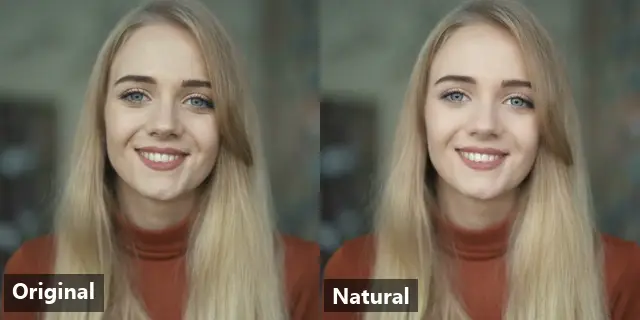
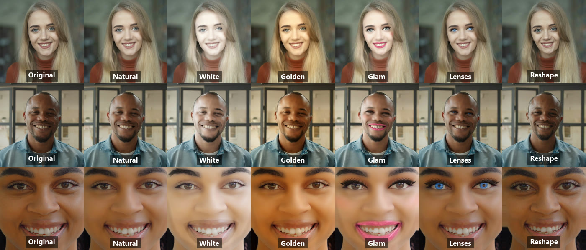
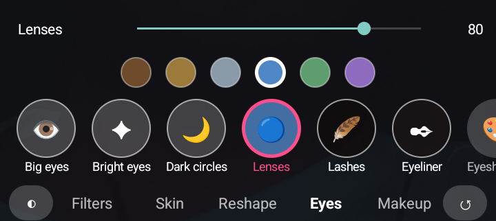

# FaceBeauty

[](https://jitpack.io/#Nahidhasan24/FaceBeauty)

Real-time, on-device face beautification for Android: skin retouch, face reshape, makeup, eye effects and colour filters, similar to Snapchat or TikTok beauty. It is built for **low-end phones** and **live video**, with a drop-in [LiveKit](https://livekit.io) integration.

<p align="center"></p>

* **On-device.** Nothing leaves the phone. MediaPipe's 478-point face landmarks run on the CPU; every effect is a GPU shader.
* **Fast on budget hardware.** Measured on a Helio G85 / Mali-G52 phone: 24 fps camera-in and video-out, about 10–14 ms of GPU per frame with every effect on.
* **Frame-accurate.** Makeup, lipstick and reshaping are computed from the landmarks of the *same* frame, so they never slide off the face, even when the landmark model is slower than the camera.
* **Ready-made UI.** A TikTok-style effect selector (`BeautyPanelView`), or build your own from `BeautyCatalog`.
* **Java and Kotlin.** The library is written in Java. Every example below is shown in both languages, and the **[Java guide](docs/java.md)** walks through every integration in Java.

| Category | Effects |
|---|---|
| Filters | Natural, White, Golden, Silky, Glow, Fresh, Rosy, Peach, Milk, Bronze, Mono, and custom LUT images (PNG) |
| Skin | Smooth, Whiten, Skin tone (golden, peach, porcelain, bronze, rosy), Rosy, Clarity, Dark circles, Smile lines, Highlight, Neck match |
| Reshape | Big eyes, Slim face, Small face, V chin, Chin length ±, Cheekbones, Forehead ±, Slim nose, Nose length ±, Mouth ±, Eye distance ± |
| Eyes | Bright eyes, Coloured lenses, Lashes, Eyeliner, Eyeshadow, Dark circles |
| Makeup | Lipstick (with gloss), Blush, Eyeshadow, Eyeliner, Lashes, Teeth whitening |



<p align="center"></p>

<sub>Every frame above was rendered by this library (`BeautyImageProcessor.processVideoFrame`) on a Helio G85 phone. Source footage: free stock clips from [Mixkit](https://mixkit.co) ([4756](https://mixkit.co/free-stock-video/girl-smiling-portrait-in-the-library-4756/), [4535](https://mixkit.co/free-stock-video/portrait-of-a-smiling-man-4535/), [4883](https://mixkit.co/free-stock-video/a-girls-face-in-detail-while-smiling-4883/)), used under the Mixkit Stock Video Free License.</sub>

## Install (JitPack)

```kotlin
// settings.gradle.kts
dependencyResolutionManagement {
    repositories {
        google()
        mavenCentral()
        maven { url = uri("https://jitpack.io") }
    }
}

// app/build.gradle.kts
dependencies {
    implementation("com.github.Nahidhasan24.FaceBeauty:beauty:1.0.1")
    // Only for LiveKit video calls (your app provides io.livekit:livekit-android):
    implementation("com.github.Nahidhasan24.FaceBeauty:beauty-livekit:1.0.1")
}

android {
    // Lets the library memory-map the 3.6 MB face model instead of copying it into RAM.
    androidResources { noCompress += "task" }
}
```

Groovy (`settings.gradle` / `app/build.gradle`):

```groovy
dependencyResolutionManagement {
    repositories {
        google()
        mavenCentral()
        maven { url 'https://jitpack.io' }
    }
}

dependencies {
    implementation 'com.github.Nahidhasan24.FaceBeauty:beauty:1.0.1'
    implementation 'com.github.Nahidhasan24.FaceBeauty:beauty-livekit:1.0.1'   // LiveKit only
}

android {
    androidResources { noCompress 'task' }
}
```

Requirements: `minSdk 24`, OpenGL ES 2.0+, camera permission. The face model ships inside the AAR, and R8/ProGuard rules are applied automatically.

## Quick start: LiveKit video call

**Kotlin**

```kotlin
val beauty = BeautyVideoProcessor(context, room.lkObjects.eglBase)
beauty.setParams(BeautyParams.natural())

val track = room.localParticipant.createVideoTrack(
    name = "camera",
    capturer = BeautyCameraCapturer.create(context, /* front = */ true),
    options = LocalVideoTrackOptions(position = CameraPosition.FRONT, captureParams = VideoPreset169.H720.capture),
    videoProcessor = beauty,
)
track.startCapture()
room.localParticipant.publishVideoTrack(track)

// Effect selector bound to the call:
val panel = BeautyPanelView(context)
panel.setListener { params -> beauty.setParams(params) }
panel.setCompareListener { original -> beauty.isEnabled = !original }
```

**Java**

LiveKit's API is Kotlin-first (default arguments, `suspend` functions), so `BeautyLiveKit` wraps the calls Java needs:

```java
Room room = LiveKit.INSTANCE.create(getApplicationContext(), new RoomOptions(), new LiveKitOverrides());
BeautyVideoProcessor beauty = new BeautyVideoProcessor(this, room.getLkObjects().getEglBase());
beauty.setParams(BeautyParams.natural());

// Beautified front-camera track (capture starts; local preview works before connecting).
LocalVideoTrack track = BeautyLiveKit.createCameraTrack(this, room, beauty, true, VideoPreset169.H720.getCapture());
track.addRenderer(renderer);                 // after room.initVideoRenderer(renderer)

BeautyLiveKit.connect(room, url, token, new BeautyLiveKit.Callback<Object>() {
    @Override public void onSuccess(Object unused) { BeautyLiveKit.publish(room, track, null); }
    @Override public void onError(Throwable error) { Log.e("Call", "connect failed", error); }
});

// Effect selector bound to the call:
BeautyPanelView panel = new BeautyPanelView(this);
panel.setListener(beauty::setParams);
panel.setCompareListener(original -> beauty.setEnabled(!original));
```

A complete Java screen is in [`LiveKitJavaActivity.java`](app/src/main/java/com/facebeauty/sample/LiveKitJavaActivity.java).

## Quick start: camera preview

```xml
<com.facebeauty.BeautyGLView
    android:id="@+id/beautyView"
    android:layout_width="match_parent"
    android:layout_height="match_parent" />
```

**Kotlin**

```kotlin
beautyView.setParams(BeautyParams.glow())
preview.setSurfaceProvider(mainExecutor) { request ->           // CameraX Preview use case
    val res = request.resolution
    beautyView.requestInputSurface(res.width, res.height) { st ->
        val surface = Surface(st)
        request.provideSurface(surface, mainExecutor) {
            surface.release()
            beautyView.releaseInputSurface(st)
        }
    }
}
```

**Java**

```java
beautyView.setParams(BeautyParams.glow());
preview.setSurfaceProvider(mainExecutor, request -> {           // CameraX Preview use case
    Size res = request.getResolution();
    beautyView.requestInputSurface(res.getWidth(), res.getHeight(), st -> {
        Surface surface = new Surface(st);
        request.provideSurface(surface, mainExecutor, result -> {
            surface.release();
            beautyView.releaseInputSurface(st);
        });
    });
});
```

A complete Java camera screen (CameraX, effect panel, capture, photo editing) is in [`MainActivity.java`](app/src/main/java/com/facebeauty/sample/MainActivity.java).

## Documentation

| Guide | |
|---|---|
| **[Java guide](docs/java.md)** | **Every integration in Java: camera screen, effect panel, effects, photos and video, LiveKit, custom UI** |
| [Getting started](docs/getting-started.md) | Install, camera preview, photos, lifecycle |
| [LiveKit integration](docs/livekit.md) | Beautify a published camera track, capturer, lifecycle, settings |
| [Effects reference](docs/effects.md) | Every `BeautyParams` field, presets, filters, custom LUTs |
| [Effect selector](docs/effect-selector.md) | `BeautyPanelView` and building your own UI with `BeautyCatalog` |
| [Performance and advanced use](docs/advanced.md) | Device tiers, frame sync, custom GL pipelines, tuning |
| [Troubleshooting](docs/troubleshooting.md) | Common problems and fixes |

A runnable sample is in [`app/`](app): a CameraX preview, the LiveKit pipeline without a server, photo editing, and a model benchmark.

## Modules

| Artifact | Contents |
|---|---|
| `beauty` | Core: `BeautyGLView`, `BeautyImageProcessor`, `BeautyRenderer`, `SyncedBeautyRenderer`, `FaceTracker`, `BeautyParams`, `ColorGrade`, `BeautyConfig`, `BeautyPanelView`, `BeautyCatalog` |
| `beauty-livekit` | `BeautyVideoProcessor` (LiveKit/WebRTC `VideoProcessor`), `BeautyCameraCapturer` |

## License

Apache License 2.0, see [LICENSE](LICENSE). Third-party components (the MediaPipe Face Landmarker model and canonical face mesh, both Apache 2.0) are listed in [NOTICE](NOTICE).
